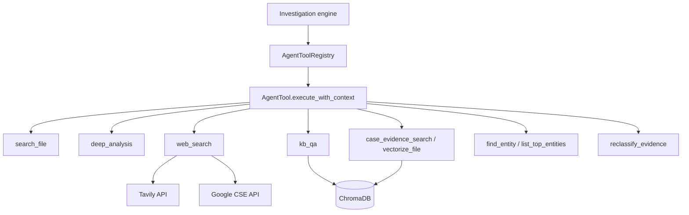

# FaultMaven Agent Tools

The tools the AI agent can call during an investigation. The code is in `faultmaven/modules/agent/tools/`.

## Overview

A tool is an `AgentTool` subclass (`faultmaven/modules/agent/tools/base.py`) with a name, a description, a JSON-Schema `parameters_schema` and an async `execute_with_context(params, context)` that returns a `ToolResult`. Tools are constructed explicitly in `register_tools` and registered in an `AgentToolRegistry` by `_create_investigation_tools`; the investigation engine hands that registry's schemas to the model on each tool-loop call.



- **Interface-based**: all tools subclass `AgentTool` (a `BaseTool`)
- **Explicit registration**: `AgentToolRegistry.register(tool)`; no decorator, no scan, no auto-discovery
- **Constructor injection**: a tool's dependencies are passed where `register_tools` builds it
- **One result shape**: `ToolResult`; failures through `tool_failure`

## Which tools exist

The [Tool Catalog](./tool-catalog.md) lists them with their files and the conditions under which the model is given each one. A document generator, metrics analyzer, trace analyzer, system-commands tool, configuration validator, MCP client or server and custom-API tool have no code; the catalog says so, and [MCP Integration](./integrations/mcp-integration.md) is a design only.

## Documents

- **[Tool Catalog](./tool-catalog.md)**: the tools the model can be given
- **[Developer Guide](./developer-guide.md)**: write, test and register a tool
- **[Tool Interface Specification](./architecture/tool-interface-spec.md)**: `AgentTool`, `ToolResult` and the lifecycle
- **[MCP Integration](./integrations/mcp-integration.md)**: design only, not implemented

## Core principles

### 1. Privacy

When `SANITIZE_PII` is on (`ProtectionSettings.sanitize_pii`, default off), the engine redacts every tool result before the model reads it (`case_redacted`, `faultmaven/core/investigation/milestone_engine/generation.py`); with it off, `case_redacted` passes the text through unchanged. A tool that calls a model with case content itself (`kb_qa`, `case_evidence_search`, `deep_analysis`) sends its messages through `case_redacted_messages(messages, context.redaction_ctx)` (`faultmaven/infrastructure/security/model_content.py`), which redacts under the same switch and mints the content the model boundary requires; unminted content raises `RawModelContentRefused`, which a tool re-raises and never turns into `tool_failure`. No tool sanitizes its own params. An unexpected exception goes through `tool_failure`, which names its class, never its text (#2332); a tool may still return a message written for the model on purpose (`reclassify_evidence` returns its typed domain errors' text, `search_file` the `re.error` text of the model's own pattern).

### 2. Registration is by hand

Construct the tool in `register_tools` (`faultmaven/container/providers/tools.py`) and add it to `_create_investigation_tools` (`faultmaven/container/providers/services.py`). The [Developer Guide](./developer-guide.md) walks through it.

```python
class CustomValidatorTool(AgentTool):
    # name, description and parameters_schema properties
    async def execute_with_context(
        self, params: Dict[str, Any], context: ToolContext
    ) -> ToolResult:
        # Implementation
        pass
```

### 3. Standardized results

```python
class ToolResult(BaseModel):          # faultmaven/models/interfaces.py
    success: bool                     # Execution succeeded?
    data: Any                         # Tool output; required, None on a failure
    error: Optional[str] = None       # Reason if failed; an unexpected exception's text is never put here (tool_failure)
    timed_out: bool = False           # The failure was a timeout, by exception class
```

A failure is built with `tool_failure(reason, exc, *, guidance="")` (`faultmaven/modules/agent/tools/base.py`).

## Which tools are registered

There is no discovery step. At startup:
1. `register_tools` constructs each tool and sets it on the container
2. `_create_investigation_tools` registers the ones the model is given in an `AgentToolRegistry`
3. The engine receives that registry

The set: `search_file`, `deep_analysis` (unless `DEEP_ANALYSIS_BACKEND=disabled`), `web_search` (when enabled and configured), `kb_qa` and `case_evidence_search` (both unless `SKIP_SERVICE_CHECKS`, which builds no vector store), `vectorize_file` (beside `case_evidence_search`), plus `find_entity` / `list_top_entities` and `reclassify_evidence` under their flags. The startup log line "DA tool registry: N tools registered" names the set.

## Configuration

Web search is the one tool with its own keys. Set in `.env`:

```env
# Tavily preferred, Google CSE fallback
TAVILY_API_KEY=tvly-xxx
WEB_SEARCH_API_KEY=your_google_api_key
WEB_SEARCH_ENGINE_ID=your_engine_id
ENABLE_WEB_SEARCH=true
```

`DEEP_ANALYSIS_BACKEND` is `local` (default) or `disabled`. Settings are defined in `faultmaven/config/settings.py`; `.env.example` is the template.
